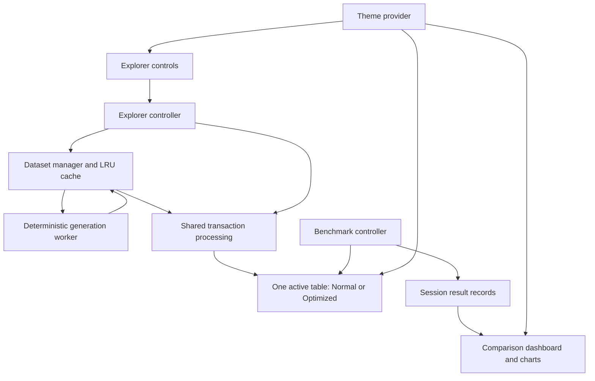
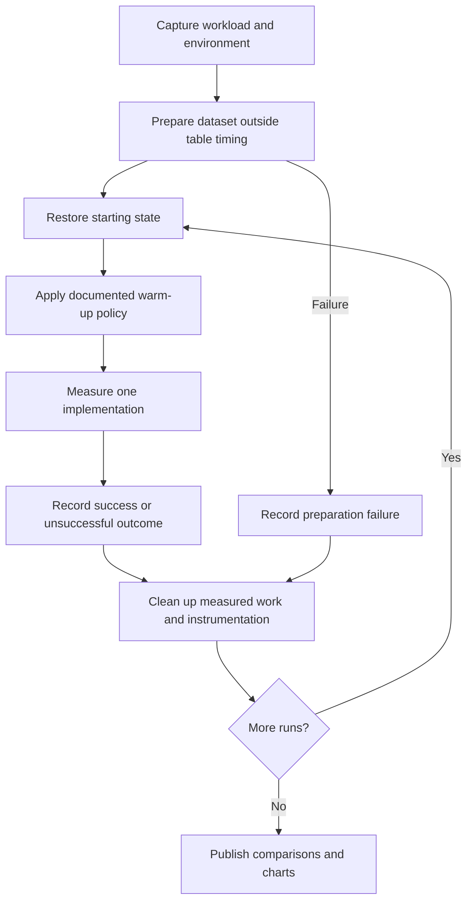

# Financial Transaction Performance Lab — Architecture

**Status:** Approved architecture decisions documented; implementation pending.

This overview records the developer-approved MVP architecture. [PROJECT.md](PROJECT.md) provides the project vision; [REQUIREMENTS.md](REQUIREMENTS.md) defines product behavior and acceptance criteria. The developer confirmed that the requirements are approved, although their status line still mentions review. This task does not modify that document.

The repository currently contains a minimal React + TypeScript application using Vite. The architecture below is the intended implementation, not a claim that modules, dependencies, tests, or benchmarks already exist. No performance improvement has been established by these decisions.

## 1. System overview and principles

Use a single feature-based React + TypeScript SPA. Preserve existing infrastructure, separate domain behavior from presentation, make ownership explicit, and keep the naive reference intact. Normal and Optimized must use identical datasets, processing semantics, and displayed values. Compare presents recorded evidence from sequential runs.

The approved additions are `@tanstack/react-virtual`, Tailwind CSS, selectively adopted shadcn/ui components, Recharts, Jest, React Testing Library, and Cypress. They are not installed by this documentation task. No Redux Toolkit, external caching library, dashboard template, Vitest, or Playwright is selected. Faker.js and MSW remain proposed options in the project vision, not approved dependencies.

## 2. Feature modules and component boundaries

The following are logical responsibilities rather than a mandated source-directory layout:

| Boundary | Owns | Does not own |
| --- | --- | --- |
| Application shell and reusable UI | Dashboard composition, layout, shared accessible controls | Transaction processing or benchmark measurements |
| Transaction explorer controller | Dataset/mode selections, search, sort, status/type filters | Duplicate transaction datasets |
| Dataset manager | Worker requests, immutable datasets, two-entry LRU cache | Table rendering |
| Shared transaction domain | Model, deterministic generation rules, search/filter/sort semantics, display conventions | UI state or benchmark lifecycle |
| Normal table | All matching row rendering | Alternative processing semantics |
| Optimized table | Virtualized row rendering and scrolling | Reduced workloads or altered results |
| Benchmark controller | Sequential execution, measurement boundaries, cleanup | Live chart presentation during measured work |
| Result state and comparison dashboard | Session outcomes, compatibility checks, numerical/chart presentation | Re-running tables just to display saved results |
| Theme provider | User preference and resolved appearance | Explorer selections |

The runner coordinates preparation and shared processing as well as rendering; the diagram shows ownership, not timing boundaries. No separate API service, microfrontend, or backend is required.

## 3. State management and data ownership

Use `useReducer` for explorer selections: dataset size, mode, search query, date/amount sort field and direction, status filters, and credit/debit filters. Keep isolated UI interactions in local `useState`. Theme Context owns the selected preference and resolved theme. Benchmark execution and recorded results have separate state from the explorer and from each other.

The dataset manager retains generated records; controllers and tables reference them instead of storing duplicate copies of 100,000 records. Derived ordered collections may reference records but must not mutate the source array or record values. Current selections survive Normal/Optimized/Compare switching. Reset clears search and filters and restores date-descending order while retaining dataset, mode, and theme.

A benchmark captures its own configuration so subsequent UI changes cannot silently rewrite a running workload or prior results. Results retain metadata, not entire transaction datasets.

## 4. Dataset generation, caching, and worker lifecycle

The model contains exactly `id`, `date`, `merchant`, `category`, `type`, `amount`, `status`, and `paymentMethod`. Use INR initially. Amount is a non-negative integer count of paise; credit means incoming and debit means outgoing. Display rupees with two decimal places and accessible direction. No per-record currency or description field is required.

Generate exactly 10K, 50K, or 100K records in a Web Worker using a documented seed, generation version, fixed date range, value distributions, and vocabularies. Do not depend on uncontrolled randomness or the current date. Cache keys comprise generation version, seed, and size. A hit reuses dataset identity and updates recency; a miss invokes the worker. The LRU retains at most two cached datasets and evicts the least recently used entry on insertion when full.

Track request and dataset identity so a response for an old selection cannot replace current data. Preparation errors must not present an old dataset as the new selection. On owner cleanup, invalidate pending responses, release listeners, and terminate owned workers. Record preparation separately from table benchmarks and wait for it to complete before measuring table work.

Worker delivery can incur serialization/structured-clone costs and transient record duplication. Eviction only releases the cache's reference; active consumers and garbage collection affect actual memory lifetime. Two cache entries are not a cap on total heap usage: derived collections and worker allocations also count. Document these costs instead of claiming that worker generation is free.

## 5. Shared search, sorting, and filtering flow

1. Read immutable records and current explorer selections.
2. Apply case-insensitive merchant/ID substring search with query-edge whitespace trimming. Empty search is unrestricted; a complete normalized query matches within either field.
3. Apply status and type filters. Values within one filter combine with OR; filters and search combine with AND. Empty selections impose no restriction.
4. Sort by chronological date or numeric paise magnitude, ascending or descending, with the same documented ID tie-break rule. Default to date descending.
5. Supply identical ordered records, matching counts, and display semantics to the active table.

Both versions initially share this processing path to isolate rendering differences. Rendering-only benchmarks consume preprocessed results; end-to-end interaction benchmarks include the action, shared processing, and resulting render. A later processing optimization is a separate documented experiment, not an implicit part of virtualization.

## 6. Table rendering approaches

Normal renders all matching rows. It remains intentionally naive and may become slow or fail on large workloads. A warning may explain that limitation but must not silently change the dataset, reduce rows, or substitute virtualization.

Optimized uses `@tanstack/react-virtual` to render visible rows with appropriate overscan. It must expose every matching record through scrolling and preserve order, values, counts, table semantics, keyboard access, and visible focus. Record relevant scroll/viewport and overscan conditions for comparisons. Choose concrete settings during implementation and document them rather than treating them as established benchmark results.

Virtualization introduces sizing, scrolling, focus, and assistive-technology trade-offs. Off-screen rows are not necessarily present in the DOM; browser find and printing may differ. Validate required accessibility and access to records, document observed limitations, and resolve MVP blockers. Neither library adoption nor fewer DOM nodes proves that every interaction is faster.

## 7. Benchmark execution lifecycle

Normal and Optimized run sequentially with identical dataset identity and workload configuration. Restore the defined starting state, including relevant scroll state, before each measured workload. Record order, repetitions, warm-up policy, and cold/warm assumptions. Only one implementation performs work; remove inactive-table background activity. Prevent stale requests, listeners, timers, and instrumentation from contaminating later samples.

Measurement definitions must specify units, collection method, start/completion boundaries, and included work. Rendering-only runs exclude generation and shared processing; end-to-end search/sort/filter runs include shared processing. Both exclude dataset preparation, which is reported separately. Collection candidates include Browser Performance API, React Profiler, scoped DOM inspection, DevTools, and supported memory APIs.

Keep application durations, React render durations, DOM counts, paint, and user-perceived completion distinct. React commit or animation-frame timing alone must not be labeled as proof of painted pixels. Record build and instrumentation conditions, including profiling overhead and development StrictMode effects. Exact collection procedures must be defined when instrumentation is implemented; this documentation does not invent a universal completion signal.

Record interrupted, failed, and incomplete runs and their reasons. Do not turn unavailable measurements into zeros, shrink a slow workload, or hide unsuccessful attempts. Main-thread stalls can delay cancellation; immediate interruption is not guaranteed. Report all samples or an inspectable equivalent, sample count, summary statistic, variability, and reasons for exclusions. There is no predetermined speedup threshold.

For every project metric candidate, identify whether it is collected, separately measured, unsupported, unavailable, not applicable, or not yet measured. Network measurements may be irrelevant to local synthetic data; memory APIs vary by environment. Core Web Vitals and bundle size are not per-table interaction timings and require separate scope and attribution notes.

## 8. Results and comparison management

Store execution state and recorded outcomes separately in memory for the current session. Records contain dataset identity/seed/version/size, implementation, workload class and settings, measurement method/boundaries/units, available environment and revision metadata, theme/viewport, repetition and warm-up context, status/failures, and limitations. Preserve original context when the explorer changes.

Compatibility checks compare dataset, workload and starting state, metric definition, units, environment/build/instrumentation, and run protocol. Unknown metadata must be disclosed rather than treated as proof of comparability. Compare may display incompatible records with explanations, but must not calculate a valid-looking improvement from them.

Show absolute measurements alongside percentages. For lower-is-better metrics, a labeled reduction is `(Normal - Optimized) / Normal * 100`, only when compatible measured values exist and Normal is nonzero; a negative reduction is a regression. Do not assume all metrics have that direction. Missing results show a reason instead of zero.

Compare reads results without simultaneous large table execution. Session reload loses results; permanent history and downloads are excluded.

## 9. Design system, themes, and visualization

Use Tailwind CSS, selectively adopted shadcn/ui components, and CSS-variable design tokens for an original financial observability dashboard. Tokens support coherent typography, spacing, semantic colors, and focus treatment. Compose clear dataset/mode controls, explorer controls, transaction results, metric cards, and charts across desktop, tablet, and mobile. Confine wide table scrolling to an understandable region.

Theme Context tracks preference separately from resolved appearance. Light/Dark override the device; System is the default and responds to device changes. Persist preference through localStorage when available, handle malformed or inaccessible storage gracefully, and clean up preference listeners. Resolve the initial theme early where feasible to avoid a distracting flash. Theme changes preserve explorer state; benchmark comparisons hold theme constant.

Use Recharts for real duration comparisons, dataset-size trends, DOM-count comparisons, and sample details where applicable measurements exist. Trends may vary dataset size intentionally, with other conditions held comparable and each point identified. Never fabricate missing points. Provide units, labels, textual/tabular equivalents, accessible non-color-only distinctions, and Light/Dark styling. Keep chart updates outside measured table intervals.

Meet applicable WCAG 2.2 AA requirements, including contrast, keyboard operation, accessible names, visible focus, and reduced-motion preferences. Selected components and charts still require review; adoption does not establish compliance. Consider bundle size and chart-rendering cost without mixing those costs into table-only claims.

## 10. Testing and quality strategy

| Layer | Approved tools | Main responsibilities |
| --- | --- | --- |
| Unit | Jest | Deterministic generation, LRU recency/eviction, reducer, shared processing, comparison compatibility and calculations |
| Component/integration | React Testing Library + Jest | Controls, mode continuity, themes/storage failures, empty/error states, key accessibility behavior, stale dataset responses and cleanup |
| Browser E2E | Cypress | Navigation, dataset switching, search/sort/filter workflows, modes, themes, browser integration |
| Performance investigation | Browser Performance API, React profiling, DevTools | Controlled measurements and interpretation under the documented protocol |
| Manual review | Browser, keyboard, assistive technology | Responsive layouts, virtualized access, focus, contrast, theme and chart presentation |

Jest needs appropriate TypeScript/JSX transformation and jsdom configuration in this Vite/ESM application, plus suitable worker/style handling. No transformer package or additional testing architecture is selected here. Vitest and Playwright are not approved. Cypress verifies functionality; its execution duration is not primary application performance evidence.

The existing pipeline runs lint, TypeScript validation, and a production build. It should eventually include applicable automated test checks after configuration, but this task changes neither dependencies nor CI. Map verification evidence to AC-01 through AC-11, including parity across all three sizes, repeated benchmark outcomes, and accessibility review. Do not disable checks or conceal incomplete large-data runs.

## 11. Major trade-offs

- Feature boundaries and built-in state keep ownership explicit but require coordination between explorer and runner.
- Worker generation avoids doing generation work on the main thread but still has delivery, transient memory, and lifecycle costs.
- A two-dataset LRU bounds cache retention, not total browser memory, and switching among three sizes can cause regeneration.
- Shared processing improves comparison fairness but can remain an end-to-end bottleneck.
- All-row Normal rendering may stall; virtualization introduces scroll and accessibility complexity.
- Sequential runs reduce simultaneous contention but cannot eliminate device variability, ordering effects, or garbage collection.
- Session-only results simplify persistence but disappear on reload.
- UI/chart libraries reduce custom work while adding bundle, rendering, styling, and accessibility-review obligations.
- Jest/RTL/Cypress provide layered coverage but need configuration; functional test success is not benchmark evidence.

## 12. Decision records

| ADR | Decision |
| --- | --- |
| [ADR-001](adr/001-feature-based-spa.md) | Single feature-based React + TypeScript SPA |
| [ADR-002](adr/002-state-management.md) | Built-in React state ownership |
| [ADR-003](adr/003-data-flow.md) | Unidirectional flow and component boundaries |
| [ADR-004](adr/004-dataset-generation-caching.md) | Worker generation and two-dataset LRU |
| [ADR-005](adr/005-transaction-processing.md) | Shared deterministic processing |
| [ADR-006](adr/006-rendering-strategy.md) | All-row baseline and virtualized optimized table |
| [ADR-007](adr/007-benchmarking.md) | Controlled sequential benchmark runner |
| [ADR-008](adr/008-benchmark-results.md) | Session results and compatible comparisons |
| [ADR-009](adr/009-design-system-theming.md) | Tailwind, selective shadcn/ui, tokens, themes |
| [ADR-010](adr/010-chart-visualization.md) | Recharts with accessible evidence presentation |
| [ADR-011](adr/011-testing-strategy.md) | Jest, React Testing Library, Cypress |

## 13. MVP boundaries and future enhancements

The MVP is limited to the approved fields, INR, three dataset sizes, merchant/ID search, date/amount sorting, status/type filtering, Normal/Optimized/Compare, Light/Dark/System, and reproducible benchmark presentation. Preserve the acceptance criteria in [REQUIREMENTS.md](REQUIREMENTS.md).

Future scope includes additional fields and currencies, advanced search/sort/filter operations, transaction editing, imports/exports, real financial integrations, accounts, backend persistence, permanent benchmark history, and advanced financial analytics. The separate API orchestration, memory leak lab, resilience, enterprise security, and reusable component architecture modules remain excluded. Microfrontends and Redux Toolkit are not part of this architecture.

Concrete generation distributions, ID tie-break details, overscan settings, visual token values, instrumentation procedures, and test configuration remain implementation details to document and validate under the approved decisions. They are not measured results or newly approved technology choices. Any additional architectural decision requires developer approval. No deployment, publishing, or Git operations beyond the working branch are authorized by these documents.
